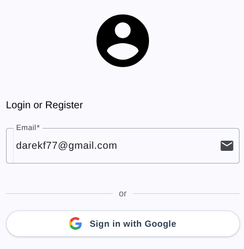
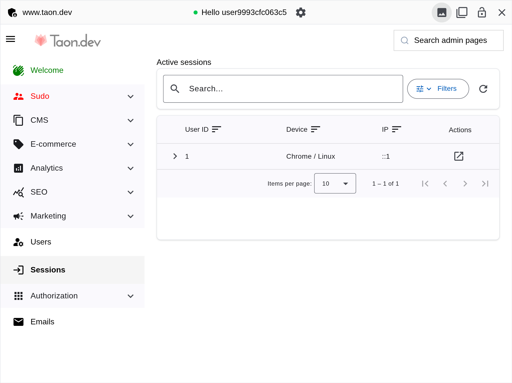
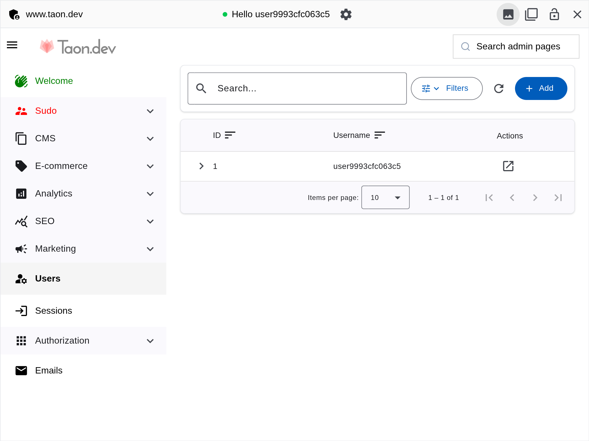
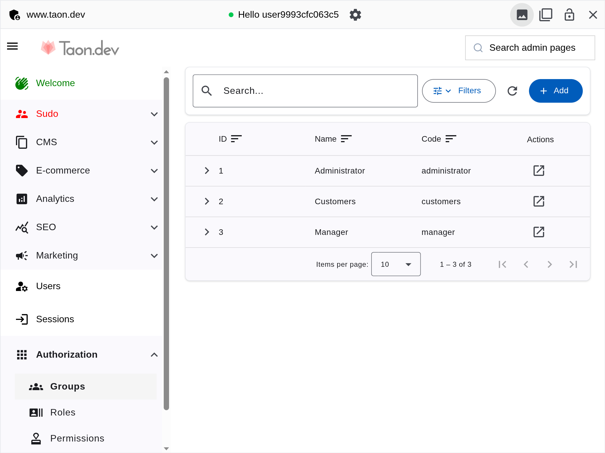
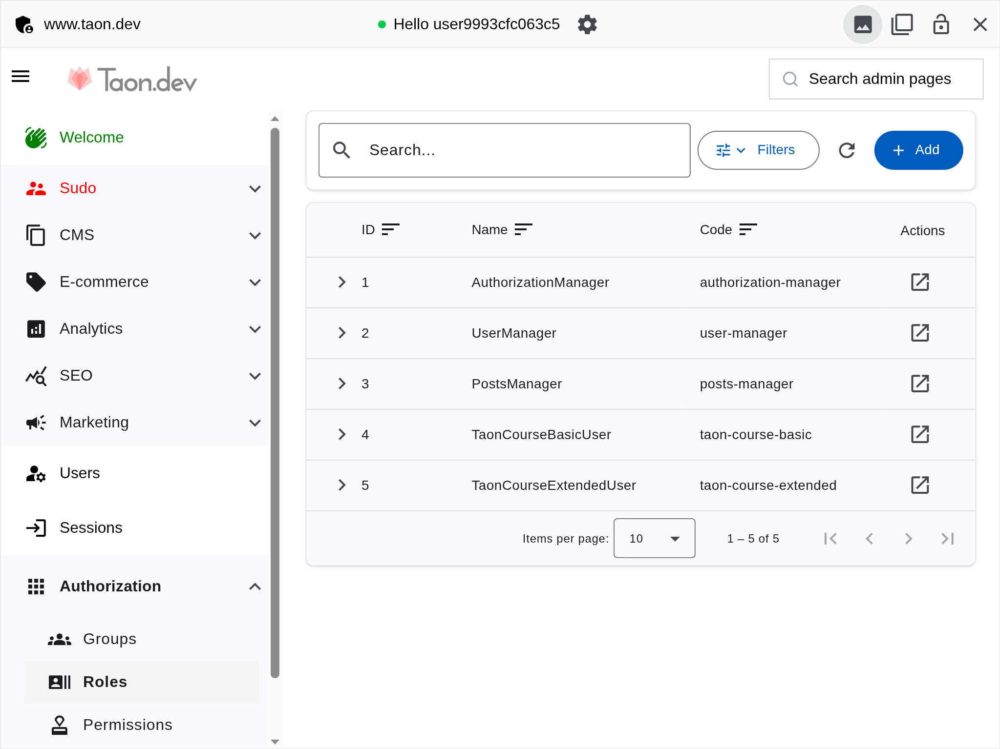
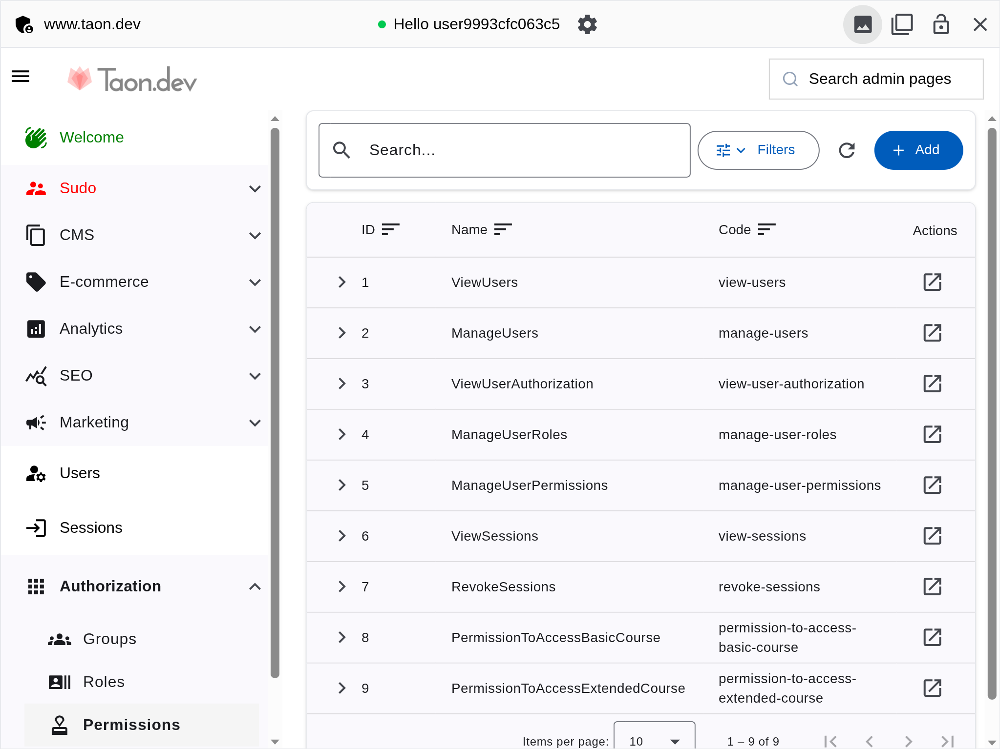

# @taon-dev/session

`@taon-dev/session` adds authentication and role-based access control (RBAC) to Taon applications. It provides an Angular sign-in interface, server-side session checks, and backoffice pages for managing users and access.

- **Authentication** covers sign-in, registration, and session handling with JWTs, cookies, and HTTP headers.
- **Authorization** uses groups, roles, and permissions to control what signed-in users can do.

The package is designed for applications built with Taon.

## Add sign-in to your Angular application



Use `TaonSessionButtonComponent` to open the sign-in dialog from an existing page. Use `TaonSessionComponent` when sign-in needs a dedicated page. In both cases, import the component that matches the selector in your template.

### Sign-in button and dialog

```ts
import { Component } from '@angular/core';
import {
  TaonSessionButtonComponent,
  type TaonSessionConfig,
} from '@taon-dev/session/src';

@Component({
  selector: 'app-sign-in',
  imports: [TaonSessionButtonComponent],
  template: `<taon-session-button [config]="config" />`,
})
export class SignInComponent {
  readonly config: TaonSessionConfig = {
    login: {
      linkToDashboard: '/my-dashboard',
    },
  };
}
```

### Dedicated sign-in page

```ts
import { Component } from '@angular/core';
import {
  TaonSessionComponent,
  type TaonSessionConfig,
} from '@taon-dev/session/src';

@Component({
  selector: 'app-sign-in-page',
  imports: [TaonSessionComponent],
  template: `<taon-session [config]="config" />`,
})
export class SignInPageComponent {
  readonly config: TaonSessionConfig = {
    login: {
      linkToDashboard: '/my-dashboard',
    },
  };
}
```

Set `login.linkToDashboard` to the route users should reach after signing in. In isomorphic source files, scope the Angular imports to the browser build using your project's Taon build markers.

## Protect an endpoint with session middleware

Add `TaonSessionMiddleware` to an endpoint that requires a signed-in user. Put it before inherited middleware so subsequent middleware can use the user and session IDs attached to the request.

```ts
import { TaonSessionMiddleware } from '@taon-dev/session/src';
import { GET, Taon, TaonBaseController, TaonController } from 'taon/src';

@TaonController({
  className: 'AccountController',
})
export class AccountController extends TaonBaseController {
  @GET({
    middlewares: ({ parentMiddlewares }) => ({
      TaonSessionMiddleware,
      ...parentMiddlewares,
    }),
  })
  me(): Taon.Response<string> {
    //#region @websqlFunc
    return async req => {
      return `User ID: ${req.userId}`;
    };
    //#endregion
  }
}
```

## Protect controller methods with `beforeEachRequest`

Use the `beforeEachRequest` hook to apply access rules to selected methods, including inherited methods such as `paginationQuery`. First authenticate the request, then check the signed-in user's access.

In this example, the hook requires permission to manage posts before running `paginationQuery`. To apply the same rule to every endpoint on a controller, remove the method-name check.

```ts
import { TaonSessionRepository } from '@taon-dev/session/src';
import {
  getStatusCode,
  HttpStatusEnum,
  Models,
  Taon,
  TaonBaseCrudController,
  TaonController,
} from 'taon/src';

import { AppAuthContextRepository } from './app-auth';

@TaonController({
  className: 'PostsController',
})
export class PostsController extends TaonBaseCrudController {
  private readonly session = this.inject(TaonSessionRepository);
  private readonly auth = this.inject(AppAuthContextRepository);

  override async beforeEachRequest({
    req,
    res,
    methodConfig,
  }: Models.TaonCtrlBeforeEachRequestParams<PostsController>): Promise<void> {
    if (methodConfig.methodName !== 'paginationQuery') {
      return;
    }

    await this.session.throwIfNotAuthenticated({ req, res });

    const context = await this.auth.getContext(req.userId, req.sessionId);

    if (!context?.hasAccess?.toManagePosts) {
      Taon.error({
        status: getStatusCode(HttpStatusEnum.FORBIDDEN),
        message: 'You do not have permission to manage posts.',
      });
    }
  }
}
```

Use your app's translation helper for the error message if your API returns localized errors.

## Extend authorization for your application

Extend the default groups, roles, and permissions with application-specific entries. Define a named access rule such as `toManagePosts` so controllers and Angular components can use the same rule.

| RBAC concept | Example | Purpose |
| --- | --- | --- |
| Group | `editorial` | Organizes users by team or responsibility. |
| Role | `posts-manager` | Represents a set of responsibilities that can be assigned together. |
| Permission | `manage-posts` | Represents access to a specific action. |

### Define groups, roles, and permissions

Add these definitions to your application's authorization module, shown here as `app-auth.ts`.

```ts
import {
  TaonSessionCoreGroupsBase,
  TaonSessionCoreRolesBase,
  TaonSessionCorePermissionsBase,
  type TaonSessionCoreAuthorizationBase,
} from '@taon-dev/session/src';

export const AppAuthGroups = {
  ...TaonSessionCoreGroupsBase,
  Editorial: 'editorial',
};

export const AppAuthRoles = {
  ...TaonSessionCoreRolesBase,
  PostsManager: 'posts-manager',
};

export const AppAuthPermissions = {
  ...TaonSessionCorePermissionsBase,
  ManagePosts: 'manage-posts',
};

export interface AppAuthorization extends TaonSessionCoreAuthorizationBase {
  groups: typeof AppAuthGroups;
  roles: typeof AppAuthRoles;
  permissions: typeof AppAuthPermissions;
}
```

### Add an access rule

Continue in the same module with a custom authorization context and repository. This example grants `toManagePosts` to superusers, members of the built-in Administrator group, and users with the `posts-manager` role. The `editorial` group and `manage-posts` permission illustrate additional RBAC entries you can use in other rules.

The backend evaluates the rule against the current authorization context. The browser reads the result from the context snapshot and can use it to show or hide UI actions. Enforce access on the backend for every protected operation.

```ts
import {
  TaonAuthContextEntityBase,
  TaonAuthContextHasAccessBase,
  TaonAuthContextRepositoryBase,
} from '@taon-dev/session/src';
import { TaonEntity, TaonRepository } from 'taon/src';

//#region authorization decorators

export const TaonSessionCoreGroups = {
  ...TaonSessionCoreGroupsBase,
  Manager: 'manager',
};

export const TaonSessionCoreRoles = {
  ...TaonSessionCoreRolesBase,
  /**
   * Can manage roles and permissions assigned directly to users.
   * Does NOT allow changing user groups.
   */
  PostsManager: 'posts-manager',

  AccessP1User: 'access-p1-user',
  AccessP2User: 'access-p2-user',
  AccessP3User: 'access-p3-user',
};

export const TaonSessionCorePermissions = {
  ...TaonSessionCorePermissionsBase,
  PermissionToAccessP1: 'permission-to-access-p1',
  PermissionToAccessP2: 'permission-to-access-p2',
  PermissionToAccessP3: 'permission-to-access-p3',
};

export interface TaonSessionCoreAuthorization extends TaonSessionCoreAuthorizationBase {
  groups: typeof TaonSessionCoreGroups;
  roles: typeof TaonSessionCoreRoles;
  permissions: typeof TaonSessionCorePermissions;
}

@TaonEntity<TaonAuthContextEntityDecorator>({
  className: 'TaonAuthContextEntity',
  createTable: false,
})
export class TaonAuthContextEntityDecorator extends TaonAuthContextEntityBase {
  declare snapshoot: Partial<TaonAuthContextHasAccess>;

  // @ts-ignore
  get hasAccess(): TaonAuthContextHasAccess {
    return this.injectClass<
      TaonAuthContextHasAccess,
      [TaonAuthContextEntityDecorator]
    >(TaonAuthContextHasAccess as any, this) as any;
  }
}

export class TaonAuthContextHasAccess extends TaonAuthContextHasAccessBase {
  // @ts-ignore
  declare protected context: TaonAuthContextEntityDecorator;

  get toManagePosts(): boolean {
    //#region @browserFunc
    return !!this.context.snapshoot.toManagePosts;
    //#endregion
    //#region @websqlFunc
    return (
      this.context.isSuperUser ||
      this.context.isInGroup(TaonSessionCoreGroups.Administrator) ||
      this.context.hasRole(TaonSessionCoreRoles.PostsManager)
    );
    //#endregion
  }
}

@TaonRepository({
  className: 'TaonAuthContextRepository',
})
export class TaonAuthContextRepositoryDecorator extends TaonAuthContextRepositoryBase<
  TaonSessionCoreAuthorization,
  // @ts-ignore
  TaonAuthContextEntityDecorator
> {
  // @ts-ignore
  entityClassResolveFn = () => TaonAuthContextEntityDecorator;
}

@TaonMigration({
  className: 'SessionContext_1791132517217_initial_decorator',
})
export class SessionContext_1791132517217_initial_decorator extends SessionContext_1791132517216_initial {
  protected async persistTree(): Promise<void> {
    //#region @websqlFunc

    console.info(`Migrating CUSTOM authorization`);

    await this.taonAuthContextRepository.persistTree({
      authorization: {
        groups: TaonSessionCoreGroups,
        roles: TaonSessionCoreRoles,
        permissions: TaonSessionCorePermissions,
      },

      tree: {
        groupAndRoles: {
          // Administrators receive all core administrative roles.
          [TaonSessionCoreGroups.Administrator]: '*',

          // Normal customers receive no administrative roles by default.
          [TaonSessionCoreGroups.Customers]: [],
          [TaonSessionCoreGroups.Manager]: [TaonSessionCoreRoles.PostsManager],
        },

        rolesAndPermissions: {
          [TaonSessionCoreRoles.AuthorizationManager]: [
            TaonSessionCorePermissions.ViewUsers,
            TaonSessionCorePermissions.ViewUserAuthorization,
            TaonSessionCorePermissions.ManageUserRoles,
            TaonSessionCorePermissions.ManageUserPermissions,
          ],
          [TaonSessionCoreRoles.PostsManager]: [],
          [TaonSessionCoreRoles.AccessP1User]: [
            TaonSessionCorePermissions.PermissionToAccessP1,
          ],
          [TaonSessionCoreRoles.AccessP2User]: [
            TaonSessionCorePermissions.PermissionToAccessP2,
          ],
          [TaonSessionCoreRoles.AccessP3User]: [
            TaonSessionCorePermissions.PermissionToAccessP2,
          ],
          [TaonSessionCoreRoles.UserManager]: [
            TaonSessionCorePermissions.ViewUsers,
            TaonSessionCorePermissions.ManageUsers,
            TaonSessionCorePermissions.ViewSessions,
            TaonSessionCorePermissions.RevokeSessions,
          ],
        },
      },
    });
    //#endregion
  }
}

//#endregion

```

Keep the framework's `snapshoot` spelling and the `@browserFunc` and `@websqlFunc` regions. They connect the browser and backend implementations of the access rule.

## Backoffice

Taon Session includes Taon Admin pages for inspecting sessions, managing user accounts, and configuring access.

### Sessions

See who is signed in and inspect the origin of each session.



### Users

Browse user accounts and inspect the groups, roles, and permissions associated with each user.



### Authorization

Manage groups, roles, and permissions from their respective pages.

#### Groups

Organize users by team or responsibility so you can manage access for users with common needs.



#### Roles

Define roles around responsibilities such as managing posts. Use roles to assign a common set of capabilities to multiple users.



#### Permissions

Define individual capabilities and use them to control access to specific actions.


